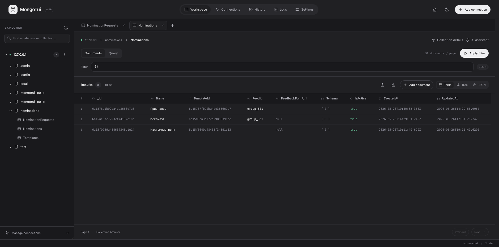
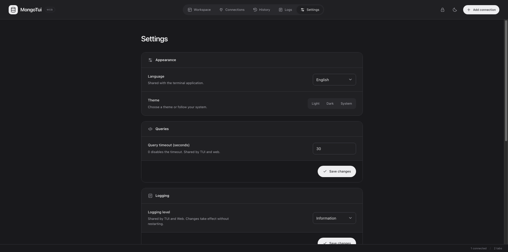

# MongoTui

[English](README.md) | **Русский**

Клиент MongoDB для терминала и браузера: просмотр баз, выполнение запросов, редактирование
документов и управление подключениями через TUI или локальный веб-интерфейс. Работает на Linux,
macOS и Windows; интерфейс доступен на русском и английском.

| Главное окно | Менеджер подключений |
|---|---|
| [](docs/work.jpg) | [](docs/connection-manager.jpg) |

| Редактор документа | Мастер-пароль |
|---|---|
| [](docs/insert-document.jpg) | [](docs/master-password.jpg) |

| Веб-интерфейс | Настройки веб-интерфейса |
|---|---|
| [](docs/web-main.png) | [](docs/web-setting.png) |

## Возможности

- Терминальный и [локальный веб-интерфейс](docs/web-interface.md) в одном приложении, с общими сохранёнными профилями, настройками и историей.
- Сохранённые подключения с шифрованием паролей, выбираемые режимы безопасности (мастер-пароль, системное хранилище на macOS/Windows или локальный файл ключа) и SSH/TPAM с 2FA.
- Дерево баз и коллекций, управление индексами, пользователями и статистика.
  Пустые базы, указанные в URI, используемые для аутентификации или перечисленные в правах пользователя, остаются видны в дереве.
  В контекстном меню подключения можно создать базу вместе с первой коллекцией, а в меню базы — создать коллекцию или открыть пустую вкладку запроса для этой базы. Новая база сразу создаётся на сервере.
  В контекстном меню базы (или подключения для `admin`) доступно управление пользователями MongoDB: создание, изменение и удаление, роли на базы и кластер, генерация пароля и готовая строка подключения.
  Для индексов показаны поля, направления и уникальность; удаление требует подтверждения.
- Вкладки JavaScript-запросов с подсветкой синтаксиса, автодополнением и историей.
  В каждой вкладке TUI над редактором показаны имя подключения и база данных.
  В истории можно выбрать сохранённое подключение, посмотреть подробности и открыть запрос без выполнения.
- Просмотр результатов в виде таблицы, дерева и JSON; редактирование документов в Canonical Extended JSON с проверкой BSON-типов.
  После добавления, сохранения или удаления документа TUI обновляет последний проверенный запрос чтения, сохраняя черновик в редакторе.
- Импорт и экспорт коллекций в JSON.
- ИИ-помощник для составления и перевода запросов через OpenAI-совместимый API.

## Требования

[Требования и установка зависимостей](docs/requirements-ru.md):
[macOS](docs/requirements-ru.md#macos) · [Linux](docs/requirements-ru.md#linux) · [Windows](docs/requirements-ru.md#windows).

## Установка

Скачайте архив для своей платформы со страницы [Releases](https://github.com/AMEST/mongo-tui/releases)
и распакуйте его целиком. Среда выполнения .NET уже включена.

Команда `mongo-tui --version` показывает версию сборки, лицензию и авторов.

### macOS — обязательно перед первым запуском

**Релизные сборки не подписаны и не нотаризованы, поэтому Gatekeeper блокирует скачанное приложение.**   
Перед первым запуском скачанной сборки откройте терминал в каталоге распакованного приложения
и снимите атрибут карантина с исполняемого файла и нативных библиотек:

```sh
xattr -d com.apple.quarantine ./mongo-tui
xattr -d com.apple.quarantine ./libe_sqlite3.dylib
xattr -d com.apple.quarantine ./libonigwrap.dylib
chmod +x ./mongo-tui
./mongo-tui
```

### Linux

```sh
chmod +x ./mongo-tui
./mongo-tui
```

### Windows

Запустите `mongo-tui.exe`.

## Веб-интерфейс

```sh
mongo-tui web --open
```

Адрес по умолчанию — `http://127.0.0.1:8765`; порт можно изменить через `--port 9000`.
Запуск `mongo-tui` без аргументов открывает терминальный интерфейс.
Для входа используется мастер-пароль. При первой настройке и в режимах keyring/локального файла
откройте одноразовую ссылку из терминала; `--open` открывает её автоматически.
Web-ресурсы встроены в приложение; папка `wwwroot` рядом с бинарником не нужна.

Подключения и настройки общие с TUI. Доступны просмотр баз и коллекций, JavaScript-запросы,
результаты в виде таблицы, дерева и JSON, редактирование документов, индексы, история, логи приложения,
импорт/экспорт JSON и ИИ-помощник. [Подробнее](docs/web-interface.md).

Режим просмотра загружает по 50 документов через драйвер; режим скрипта использует установленный
`mongosh`. В дереве доступно управление пользователями MongoDB, а из веб-истории можно открыть
запрос в новой вкладке. Перенос ограничен 32 МиБ, экспорт — 10 000 документов. Сервер предназначен
для локального доступа: оставляйте его на loopback без обратного прокси и проброса порта.

Таймаут запросов общий для TUI и веба. Он задаётся в **Настройки → Запросы**:
по умолчанию 30 секунд, `0` отключает ограничение. Изменения применяются к новым запросам.

## Начало работы

1. Запустите MongoTui и выберите способ защиты секретов: мастер-пароль (рекомендуется), системное хранилище на macOS/Windows или локальный файл ключа. Режим можно изменить позже в **Настройки → Безопасность…**.
2. Откройте **Подключение → Менеджер подключений…**, добавьте URI MongoDB, сохраните профиль
   и подключитесь. Кнопка **Из URI** заполняет поля аутентификации из полной строки подключения.
   Кнопка **Копировать URI** копирует полную строку выбранного подключения, включая учётные данные, в буфер обмена.
3. Разверните базу и откройте коллекцию клавишей **Enter** или двойным кликом.
   Появится вкладка с запросом `find`, который сразу выполнится и загрузит до 50 документов.
4. Измените запрос и нажмите **F5** или **Ctrl+R**. Режим отображения выбирается
   в меню **Настройки → Вид результата**: таблица, дерево или JSON.

Запросы используют базу текущей вкладки. Например:

```javascript
db.getCollection('users').find({ active: true }).limit(50).toArray()
```

Правый клик по узлу дерева или результату открывает доступные действия. **Новый запрос**
в меню базы открывает пустую вкладку, привязанную к этой базе; в меню коллекции — ту же вкладку,
что и двойной клик.

### Горячие клавиши

| Сочетание | Действие |
|---|---|
| `Ctrl+O` | Менеджер подключений |
| `Ctrl+T` / `Ctrl+W` | Новая вкладка / закрыть вкладку |
| `F5` / `Ctrl+R` | Выполнить выделение, а при его отсутствии — весь скрипт |
| `Alt+←` / `Alt+→` | Перейти по словам в редакторе; с Shift — выделить |
| `Home` / `End` | Перейти в начало / конец строки |
| `Ctrl+Space` | Автодополнение в редакторе; контекстное меню в дереве |
| `Ctrl+H` | История запросов |
| `F2` / `F3` | Экспорт / импорт |
| `F9` | Обновить |
| `Tab` / `Shift+Tab` | Перейти между деревом, редактором и результатами |
| `F10` | Фокус на меню |
| `Ctrl+C` | Копировать выделенный текст (на macOS — `Ctrl+C`; `Cmd+C` перехватывает терминал) |
| `Ctrl+V` / `Cmd+V` | Вставить из буфера обмена |
| `Ctrl+Q` | Выход |

В автодополнении **↑/↓** выбирают вариант, **Enter** или **Tab** вставляют его, **Esc** закрывает список.
Имена баз, коллекций и полей доступны по `Ctrl+Space`; подсказки методов также появляются при вводе.

При переполнении панели результатов появляются полосы прокрутки. Широкую таблицу можно
прокручивать горизонтальной полосой или клавишами ←/→ и Home/End.

**Навигация на macOS.** В браузерном редакторе `Cmd+←/→` переходит к границам строки,
а `Option+←/→` — по словам. В TUI терминал должен передавать Option как Alt
(либо `Esc+b` / `Esc+f`). Terminal.Gui 2.5 не различает модификатор Cmd.
Если терминал поддерживает переназначение сочетаний, задайте для `Cmd+←` отправку Home
(`ESC[H`), а для `Cmd+→` — End (`ESC[F`). Приложение не получает сочетания, которые
терминал перехватывает для собственных действий.

Полный список всегда доступен в приложении: **Справка → Горячие клавиши**. Сочетания действуют
на сфокусированную панель, поэтому `Ctrl+C` копирует и из редактора, и из результатов, и из поля диалога.

**Копирование на macOS.** Терминал перехватывает `Cmd+C` для собственного копирования и не
передаёт его приложению, поэтому в MongoTui копирование выполняется по `Ctrl+C` (в системный буфер
через `pbcopy`). Чтобы пользоваться `Cmd+C`, назначьте его в терминале на отправку `Ctrl+C`
(`0x03`) — в Terminal.app через *Настройки → Профили → Клавиатура*, в iTerm2 через *Settings → Keys*.
На Linux и в SSH-сессиях без `xclip` копирование переключается на escape-последовательность OSC 52,
которую поддерживают современные терминалы.

## Дополнительные настройки

**SSH/TPAM.** В форме подключения откройте **SSH SOCKS…** и укажите SSH-хост, порт и логин.   
Задайте файл ключа или используйте ssh-agent и настройки SSH. Запросы аутентификации,
включая 2FA, появятся внутри MongoTui. Импорт и экспорт через SOCKS недоступны.

**ИИ-помощник.** Задайте базовый URL, модель и API-ключ в **Настройки → Настройки ИИ…**.    
После этого используйте **Запрос → ИИ-помощник…** или **Перевести…**.    
Ответ отображается в диалоге. Помощник получает текущую базу, список коллекций и 
выборочные имена полей с их BSON-типами, чтобы составлять запросы по реальной схеме.

## Текущие ограничения

- Редактирование и удаление доступны для результатов простых `find`/`findOne` без проекции.
  В веб-интерфейсе также доступны документы из режима просмотра. Изменять `_id` нельзя.
  При открытии редактора существующий документ заново загружается через драйвер.
- Сохранение заменяет весь документ и может затереть изменения, внесённые после открытия редактора.
  Драйвер также превращает `Double(-0.0)` в `+0.0` при чтении; сохранение записывает это изменение.
  См. [ограничения редактирования BSON](docs/bson-json.md). Отмена или таймаут записи не откатывают её.
- В TUI режим «Дерево» выводит форматированный текст; в веб-интерфейсе узлы раскрываются.
- Для переноса используйте JSON: настройки CSV и поддержка BSON в диалогах TUI ещё не завершены.
  Dump/restore баз недоступны в интерфейсе.

## Локальные данные

Подключения, настройки и история хранятся в `~/.mongotui/mongotui.db`
(на Windows — `%USERPROFILE%\.mongotui\mongotui.db`). `MONGOTUI_DATA_DIR` меняет каталог данных.
Логи находятся в его подкаталоге `logs`. Текст shell-запросов сохраняется в истории, но не в логах.

Пароли подключений и API-ключ ИИ шифруются ключом, который защищён выбранным режимом безопасности. В режиме **Без мастер-пароля** ключ хранится в `~/.mongotui/kek.key` с правами только для владельца; любой, кто прочитает этот файл, сможет расшифровать секреты.

Уровень логирования выбирается в «Настройки → Логирование» в TUI или Web, сохраняется в локальной БД и применяется без перезапуска; см. [настройки логирования](docs/logging.md).

## Разработка

[Сборка, запуск и тесты](docs/requirements-ru.md#сборка-из-исходников) ·
[Публикация сборки](docs/requirements-ru.md#публикация-сборки) ·
[Правила проекта](AGENTS.md) · [Подготовка релиза](docs/releasing.md) · [История изменений](CHANGELOG.md).

## Авторы

Klabukov Erik (AMEST) · Соавтор: Medvedev Denis (medved91).

## Лицензия

[MIT](LICENSE). Лицензии зависимостей: [Third-party licenses](THIRD-PARTY-LICENSES.md).
