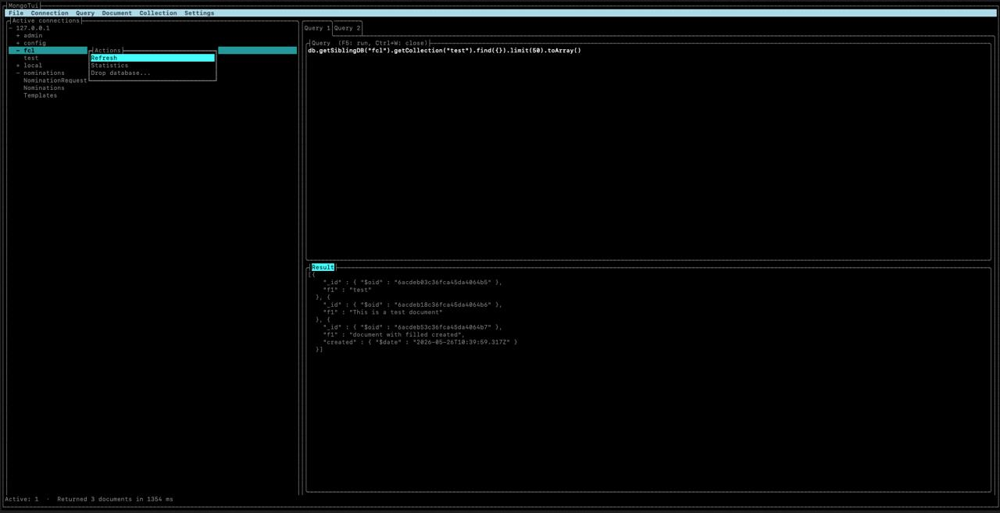
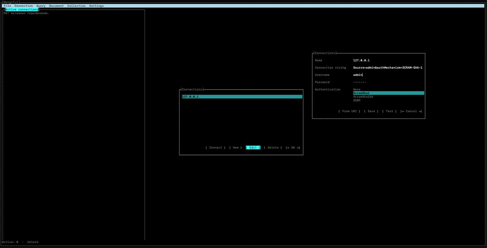
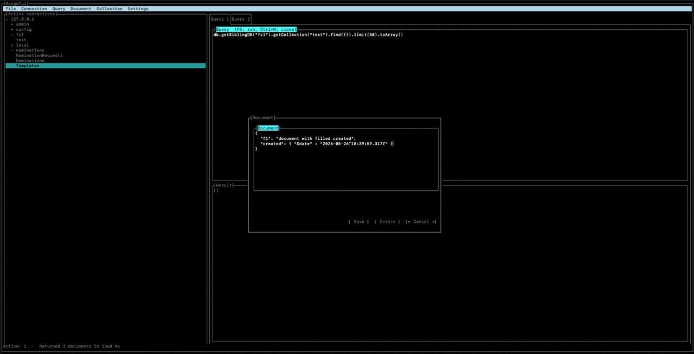
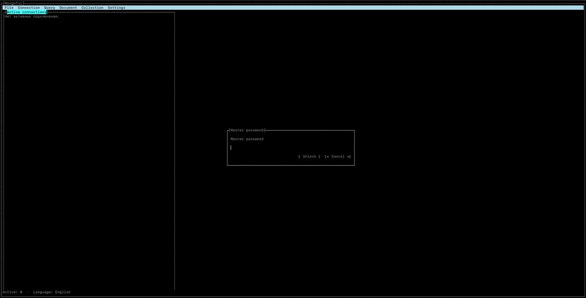

# MongoDB TUI Viewer

[English](README.md) | **Русский**

Кроссплатформенный терминальный клиент для MongoDB:
менеджер подключений, дерево серверов/баз/коллекций, вкладки запросов, просмотр и
редактирование документов, импорт/экспорт, автодополнение и ИИ-помощник на базе
OpenAI-совместимого API.

## Скриншоты

| Главное окно | Менеджер подключений |
|---|---|
| [](docs/work.jpg) | [](docs/connection-manager.jpg) |

| Добавление документа | Мастер-пароль |
|---|---|
| [](docs/insert-document.jpg) | [](docs/master-password.jpg) |
## Возможности

- **Менеджер подключений** — профили в SQLite; секреты шифруются AES-256-GCM.
- **Разблокировка секретов** — мастер-пароль с выводом ключа через Argon2id.
- **Вкладки запросов** — запросы выполняются через `mongosh --eval` с выводом Extended JSON, запуск по `F5` или `Ctrl+Enter`.
- **Панель результатов** — текстовая таблица, форматированные блоки документов (режим «Дерево») и JSON, время выполнения и ошибки.
- **Документы** — добавление / изменение / удаление в формате JSON.
- **Индексы и статистика** — список, создание и удаление индексов; счётчики документов/индексов.
- **Экспорт / импорт** — перенос коллекций в JSON через `mongoexport`/`mongoimport`; экспорт в canonical JSON.
- **Автодополнение** — `Ctrl+Space` в редакторе запросов для имён баз, коллекций и полей, включая вложенные пути; поля извлекаются из выборки и кэшируются.
- **ИИ-помощник** — генерация фильтра MongoDB find по текстовому описанию; перевод запросов (например SQL) в фильтр find или aggregation pipeline. Ответ отображается в диалоге.
- **История запросов** — просмотр последних 100 запросов подключения; **тёмная тема**, **локализация** (английский/русский).

Текущие ограничения: результаты в режиме «Дерево» — форматированный текст без раскрываемых
узлов. Варианты BSON в диалогах переноса не поддерживаются; dump/restore баз реализованы
только в Infrastructure и недоступны в TUI. Для экспорта CSV нет выбора полей, для импорта
CSV — настройки полей/заголовка; в TUI используйте JSON. История позволяет просматривать
запросы, но не запускать их повторно.

## Зависимости для работы

Установите необходимые компоненты на машине, где **запускается `mongo-tui`**. Для обычной
работы нужны интерактивный терминал, **MongoDB Shell (`mongosh`)** для вкладок запросов
и доступ к серверу MongoDB (локальному или удалённому).

| Зависимость | Когда требуется |
|---|---|
| [MongoDB Shell (`mongosh`)](https://www.mongodb.com/docs/mongodb-shell/install/) | Выполнение скриптов во вкладках запросов. Дерево подключений и операции с документами используют встроенный MongoDB-драйвер. |
| **.NET 10 runtime** | Запуск framework-dependent сборки. Готовые архивы релизов и self-contained сборки включают runtime. |
| [MongoDB Database Tools](https://www.mongodb.com/docs/database-tools/installation/) | `mongoexport` / `mongoimport` для переноса коллекций. Dump/restore баз недоступны в TUI. |
| [Клиент OpenSSH 8.4+ (`ssh`)](https://www.openssh.org/txt/release-8.4) | Автозапуск SSH/TPAM SOCKS5-прокси и интерактивный ввод 2FA через `SSH_ASKPASS_REQUIRE=force`. |

`mongosh` устанавливается отдельно от **MongoDB Database Tools**. Внешние утилиты должны
быть доступны в `PATH` процесса `mongo-tui`; `MongoToolsOptions.Directory` позволяет задать
каталог поиска утилит MongoDB. Для входа по SSH-ключу укажите файл ключа либо загрузите
нужный ключ в доступный ssh-agent.

На **Linux** даже self-contained сборке нужны системные зависимости .NET: glibc, libgcc,
libstdc++, ICU, OpenSSL, zlib, GSSAPI/Kerberos, корневые сертификаты CA и данные часовых поясов;
для отдельных версий дистрибутивов также нужен Brotli. Имена и версии пакетов зависят от ОС:
см. требования Microsoft для [Ubuntu](https://learn.microsoft.com/en-us/dotnet/core/install/linux-ubuntu-install#dependencies)
и [Debian](https://learn.microsoft.com/en-us/dotnet/core/install/linux-debian#dependencies).
Распакуйте архив релиза целиком и сохраните расположение файлов: нативные библиотеки SQLite
и Oniguruma входят в поставку приложения.

**.NET 10 SDK** требуется для сборки из исходников, **Docker** — для интеграционных тестов,
**Node.js/npm** — при установке `mongosh` через npm.

Проверьте компоненты, необходимые для используемых функций:

```sh
mongosh --version

# Экспорт/импорт коллекций
mongoexport --version
mongoimport --version

# SSH/TPAM-прокси
ssh -V

# Framework-dependent сборка: в списке должен быть Microsoft.NETCore.App 10.0.x
dotnet --list-runtimes
```

## Установка

### Готовые бинарники (без .NET runtime)

Скачайте архив для своей ОС и архитектуры со страницы [Releases](https://github.com/AMEST/mongo-tui/releases), распакуйте и
запустите бинарник `mongo-tui`. Доступные архивы: `mongotui-linux-x64`, `mongotui-linux-arm64`,
`mongotui-osx-x64`, `mongotui-osx-arm64`, `mongotui-windows-x64`.

**macOS** — бинарники не подписаны и не нотаризованы, поэтому Gatekeeper блокирует их при
первом запуске. Снимите атрибут карантина перед запуском:

```bash
xattr -d com.apple.quarantine ./mongo-tui
xattr -d com.apple.quarantine ./libe_sqlite3.dylib
xattr -d com.apple.quarantine ./libonigwrap.dylib
chmod +x ./mongo-tui
./mongo-tui
```

**Linux:**

```bash
chmod +x ./mongo-tui
./mongo-tui
```

**Windows:** запустите `mongo-tui.exe`.

### Из исходников (требуется .NET 10 SDK)

```bash
git clone https://github.com/AMEST/mongo-tui.git
cd mongo-tui
dotnet run --project src/MongoTui.TUI
```

Полный цикл сборки и тестов — в разделе [Сборка и тесты](#сборка-и-тесты), а собрать собственный
single-file бинарник можно по разделу [Self-contained сборка](#self-contained-сборка).

### Инструменты MongoDB

Установите **MongoDB Shell (`mongosh`)** для вкладок запросов и **MongoDB Database Tools**
для импорта/экспорта и dump/restore. Это отдельные пакеты; их исполняемые файлы должны быть
доступны в `PATH` (см. [Зависимости для работы](#зависимости-для-работы)).

**macOS (Homebrew):**

```bash
brew install mongodb/brew/mongosh
```

Весь набор утилит — `brew install mongodb/brew/mongodb-database-tools`.

**Linux (Debian / Ubuntu, после подключения официального репозитория MongoDB):**

```bash
sudo apt-get install -y mongodb-mongosh mongodb-database-tools
```

**Linux (RHEL / Fedora, после подключения подходящего репозитория MongoDB):**

```bash
sudo dnf install -y mongodb-mongosh mongodb-database-tools
```

**Любая платформа с Node.js (npm):**

```bash
npm install -g mongosh
```

Скачайте standalone-архивы со страниц [MongoDB Shell](https://www.mongodb.com/try/download/shell)
и [Database Tools](https://www.mongodb.com/try/download/database-tools), затем добавьте каталоги
исполняемых файлов в `PATH`. Приложение вызывает `mongosh` напрямую, поэтому установки,
доступной только через `npx mongosh`, недостаточно для выполнения запросов.

## Как пользоваться

1. Запустите приложение. Если секреты заблокированы, сначала откроется окно ввода мастер-пароля;
   затем открывается диспетчер подключений.
2. **Подключение → Менеджер подключений…** — добавьте или отредактируйте подключение. Вставьте
   полную строку подключения (с учётными данными) и нажмите **Из URI**, чтобы заполнить поля
   автоматически: логин/пароль переносятся в отдельные поля, а база и механизм аутентификации
   разбираются из строки. Выберите подключение и нажмите **Подключить** — оно появится в дереве
   **активных подключений** слева, развёрнутое на список баз (пустые помечаются как `(пустая)`).
3. **Двойной клик** по узлу дерева (или **Enter**): по подключению — свернуть/развернуть,
   по базе — загрузить и показать коллекции, по коллекции — открыть вкладку запроса с готовым
   скриптом `find`.
4. Напишите JavaScript-запрос (например `db.users.find({})`) и нажмите **F5** или **Ctrl+Enter**.
5. Смотрите результат в панели таблицы/дерева/JSON; в статус-баре — время выполнения и число
   возвращённых документов.
6. **Правый клик** по узлу дерева (или **Ctrl+Space**) открывает контекстное меню: для
   подключения — обновить/отключиться, для базы — обновить/статистика/удалить, для коллекции —
   статистика/индексы/очистить/удалить (опасные действия с подтверждением).

В редакторе нажмите **Ctrl+Space** или выберите **Запрос → Автодополнение** после начала
имени: `db.getSiblingDB("ap`, `db.us`, `db.getCollection("us` или
`db.users.find({ "profile.na`. Для `db` используется база текущей вкладки;
явный `getSiblingDB(...)` меняет этот контекст. **↑/↓** выбирают вариант, **Enter** или
**Tab** вставляют его, **Esc** закрывает подсказки или отменяет загрузку. При дальнейшем
вводе список фильтруется. Поля берутся максимум из 20 документов, включают вложенные пути
до восьми уровней и кэшируются на минуту. **F9** и выполнение запроса сбрасывают кэш полей.
Пустая коллекция и поля, не попавшие в выборку, не дают подсказок полей. Переменные
JavaScript, дополнение методов/операторов и полный разбор JavaScript не поддерживаются.

Для автозапуска SSH SOCKS5-прокси откройте **SSH SOCKS…** в форме подключения, включите
автозапуск и задайте SSH-хост, порт и логин. Для TPAM используйте порт `4422` и логин вида
`requester+user@domain+system`. Пустой путь к ключу означает использование ssh-agent и
`~/.ssh/config`; локальный порт `0` выбирает свободный порт на loopback. Сохраните параметры
SSH, затем сам профиль подключения.

Кнопки **Подключить** и **Проверить** запускают `ssh -D` и показывают запросы SSH, включая
код 2FA после входа по ключу. Ответы передаются через закрытый канал между процессами и
не сохраняются. Нужен OpenSSH 8.4+ в `PATH` с поддержкой
[`SSH_ASKPASS_REQUIRE=force`](https://man.openbsd.org/ssh.1#SSH_ASKPASS_REQUIRE).
Проверка ключа хоста использует обычные настройки SSH и `known_hosts`.

Поддерживаются URI `mongodb://` и `mongodb+srv://`. SRV/TXT-записи DNS должны разрешаться
на машине клиента; DNS-запросы не отправляются через SOCKS. В рабочий URI автоматически
добавляются `proxyHost=127.0.0.1` и фактический
`proxyPort`, заменяя существующие значения. Старые учётные данные прокси удаляются, поскольку
SOCKS5 в OpenSSH не использует аутентификацию прокси. Хосты MongoDB, параметры replica set и TLS,
а также сохранённый URI остаются прежними. SSH-процесс закрывается при отключении, неудачном
подключении/проверке и выходе. Поддерживается 2FA через SSH keyboard-interactive; запрос TPAM
внутри удалённой shell-сессии требует другого сценария, поскольку `ssh -N` не открывает shell.

Импорт/экспорт и резервное копирование/восстановление через MongoDB Database Tools недоступны
для подключений с SOCKS-прокси. Утилиты игнорируют настройки SOCKS, поэтому MongoTui блокирует
их запуск и показывает причину, чтобы предотвратить прямое подключение к MongoDB.

Обзор меню:

| Меню | Действия |
|---|---|
| Файл | Выход (Ctrl+Q) |
| Подключение | Менеджер подключений… (Ctrl+O), Отключиться, Обновить (F9), Разблокировать секреты… (F8), Сменить мастер-пароль… (Ctrl+P) |
| Запрос | Новая вкладка (Ctrl+T), Выполнить (F5/Ctrl+Enter), Закрыть вкладку (Ctrl+W), ИИ-помощник… (F6), Перевести… (F7), История… (Ctrl+H) |
| Документ | Добавить документ… (Ctrl+I), Изменить документ… (Ctrl+E), Удалить документ… (Ctrl+D) |
| Коллекция | Индексы… (Ctrl+K), Экспорт… (F2), Импорт… (F3) |
| Настройки | Вид результата (Таблица / Дерево / JSON), Язык (English / Русский), Настройки ИИ… |

## Настройки и данные

Все данные лежат в домашнем каталоге пользователя:

- **Linux / macOS**: `~/.mongotui/`
- **Windows**: `%USERPROFILE%\.mongotui\`

| Путь | Назначение |
|---|---|
| `mongotui.db` | База SQLite: подключения, настройки, история запросов |
| `logs/app-*.log` | Логи Serilog (только в файл) |

| Настройка | Где | Значение по умолчанию |
|---|---|---|
| AI base URL | Настройки → Настройки ИИ…, ключ `ai.base_url` | — |
| AI модель | Настройки → Настройки ИИ…, ключ `ai.model` | — |
| AI API-ключ | хранилище настроек, ключ `ai.api_key` | — |
| Каталог MongoDB Tools | `MongoToolsOptions.Directory` | системный `PATH` |
| Salt мастер-пароля | хранилище настроек, ключ `security.kek_salt` | создаётся при первой разблокировке |
| Проверка мастер-пароля | хранилище настроек, ключ `security.kek_check` | создаётся при первой разблокировке |
| Язык | локаль ОС (en по умолчанию, ru доступен) | `en` |

Для ИИ-помощника нужен эндпоинт, совместимый с OpenAI Chat Completions API.
Базовый URL, модель и API-ключ задаются в **Настройки → Настройки ИИ…**.

## Сборка и тесты

Требуется **.NET 10 SDK**.

Сборка и тесты всего решения:

```sh
dotnet build MongoTui.sln
dotnet test MongoTui.sln
```

Интеграционные тесты требуют Docker (Testcontainers) и помечены
`[Trait("Category", "Integration")]`. Их можно исключить:

```sh
dotnet test MongoTui.sln --filter "Category!=Integration"
```

## Self-contained сборка

Публикация одного self-contained файла (на целевой машине .NET runtime не нужен):

```sh
# Linux x64
dotnet publish src/MongoTui.TUI/MongoTui.TUI.csproj -c Release -r linux-x64 \
  --self-contained true -p:PublishSingleFile=true

# Windows x64
dotnet publish src/MongoTui.TUI/MongoTui.TUI.csproj -c Release -r win-x64 \
  --self-contained true -p:PublishSingleFile=true

# macOS (Apple Silicon)
dotnet publish src/MongoTui.TUI/MongoTui.TUI.csproj -c Release -r osx-arm64 \
  --self-contained true -p:PublishSingleFile=true
```

Другие RID: `osx-x64`, `linux-arm64`. Результат — в
`src/MongoTui.TUI/bin/Release/net10.0/<runtime>/publish/`.

Framework-dependent сборка (меньше размер, нужен .NET 10 runtime):

```sh
dotnet publish src/MongoTui.TUI/MongoTui.TUI.csproj -c Release
```

## Архитектура

Onion-архитектура из четырёх слоёв:

```
TUI (Terminal.Gui)  →  Application  →  Domain
        ↘ Infrastructure ────────────────────────↗
```

| Проект | Назначение |
|---|---|
| `MongoTui.Domain` | Чистое ядро: модели, value objects, инварианты |
| `MongoTui.Application` | Интерфейсы (abstractions) и оркестрирующие сервисы |
| `MongoTui.Infrastructure` | Реализации: Mongo, SQLite, Crypto, AI, Process |
| `MongoTui.TUI` | TUI: View, ViewModel, редактор, темы |

Доступ к MongoDB идёт через **Composite Gateway**, который роутит запросы/CRUD в
официальный драйвер, а массовые операции (экспорт/импорт, dump/restore) — в CLI
MongoDB Database Tools.

## Стек

- .NET 10 (LTS), Terminal.Gui 2.5
- MongoDB.Driver + MongoDB Database Tools
- Microsoft.Data.Sqlite + LINQ to DB (linq2db) — SQLite через LINQ, raw SQL только для миграций
- AES-256-GCM + Argon2id
- Serilog (логирование только в файл)
- xUnit + FakeItEasy + AwesomeAssertions, Testcontainers

## Конвенции проекта

- [`AGENTS.md`](AGENTS.md)

## Лицензия

MongoTui распространяется по [лицензии MIT](LICENSE).
Лицензии и уведомления зависимостей собраны в [отдельном файле](THIRD-PARTY-LICENSES.md).
